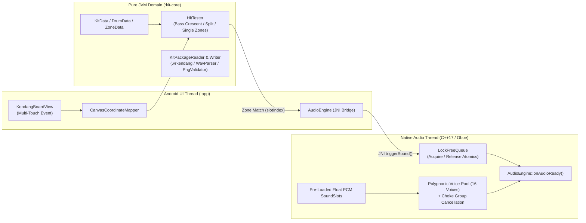

# VR Kendang — Authentic Javanese & Indonesian Traditional Percussion Instrument

[](https://github.com/Vanderrhud/kendang-android-1/actions/workflows/build-apk.yml)
-3DDC84?logo=android&logoColor=white)


[](LICENSE)

**VR Kendang** is a native Android virtual percussion instrument dedicated to preserving and simulating the expressive playing techniques of the **Kendang**—a traditional double-headed hand drum from **Java, Indonesia** that forms the rhythmic backbone of Javanese traditional music, *Gamelan*, *Campursari*, and modern *Dangdut / Koplo* ensembles.

Unlike generic Western grid-pad drum apps, **VR Kendang** is purpose-built around the physical acoustics, multi-zone membrane geometry, and rapid two-handed finger/palm articulations unique to Indonesian kendang performance, combining a **C++17 native audio engine** (Google Oboe) with a **custom mathematical membrane hit-testing engine** and a pure JVM domain core.

---

## Cultural Context & Acoustic Modeling (Why Not a Generic Drum Pad?)

Playing a traditional Javanese *Kendang* (and *Ketipung* ensemble) relies on intricate hand positioning across a single drumhead rather than striking discrete single-sound pads with sticks:

1. **Multi-Zone Membrane Articulations (*Dut*, *Deng*, *Tak*, *Tung*, *Pak*)**:
   - **Kendang Gede / Bass (`bass` model)**: Striking the center of the leather membrane produces deep resonant bass tones (*Dut* / *Deng*), while striking the outer crescent rim bands with the palm or fingertips yields progressively sharper overtones. Our geometry engine models this via an elliptical drumhead partitioned into a `main` core zone and up to 3 concentric outer `crescent` bands (`band 0–2`).
   - **Ketipung / Kendang Kecil & Sedang (`split` & `single` models)**: High-pitched interlocking patterns (*Tak*, *Tung*, *Pak*) depend on whether the player strikes the upper or lower half of the membrane. The `split` drum model divides the elliptical drumhead along a configurable angular vector (`divider.angle`) into `upper` and `lower` strike regions.
2. **Authentic Hand-Muting (*Choke Groups*)**:
   In Javanese kendang technique, an open resonant stroke is frequently dampened mid-ring by a subsequent slap or palm mute on the same drumhead. The C++ audio engine models this physically via **Choke Group Cancellation**, immediately silencing active voices in the same choke group when a muting articulation is triggered.
3. **Rapid Interlocking Syncopation**:
   Javanese *Koplo* and traditional kendang patterns involve fast, simultaneous two-handed finger rolls that are unplayable if audio latency exceeds ~15–20 ms or if touch events block the audio thread—motivating our lock-free C++17 Oboe pipeline.

---

## Key Engineering Highlights

### 1. Real-Time Lock-Free C++17 Audio Engine (`app/src/main/cpp`)
- **Zero-Allocation Audio Callback**: Built on **Google Oboe (`1.9.3`)** in `PerformanceMode::LowLatency` and `SharingMode::Exclusive` to minimize output latency on supported hardware.
- **Lock-Free SPSC Event Dispatch**: Touch triggers on the Android UI thread cross JNI into a lock-free single-producer/single-consumer ring buffer (`LockFreeQueue<TriggerEvent, 64>`) using C++11 acquire/release atomics—eliminating mutex contention or priority inversion on the real-time audio thread.
- **Pre-Decoded PCM & Sample-Rate Adaptation**: WAV assets are parsed and resampled ahead of time into 32-bit float PCM buffers (`SoundSlot` & `Resampler`) matching the hardware output sample rate, enabling deterministic polyphonic mixing (`Voice` pool with oldest-voice stealing and choke group cancellation).
- **Android 15+ 16 KB Page-Size Ready**: Compiled with NDK `r27c` (`27.3.13750724`), `-DANDROID_SUPPORT_FLEXIBLE_PAGE_SIZES=ON`, and `-Wl,-z,max-page-size=16384` ELF alignment for full compatibility with 16 KB page-size arm64 devices.

### 2. Pure JVM Domain & Geometry Core (`:kit-core`)
- **Framework-Free Architecture**: `:kit-core` is a pure Kotlin/JVM module with zero `android.*` dependencies, enabling fast, deterministic JUnit 5 tests without emulator overhead.
- **Mathematical Membrane Hit-Testing Engine (`HitTester`)**: Evaluates multi-touch coordinates against elliptical drum bounds (`rx`, `ry`), offset crescent arcs (`bass` model with `main` and `crescent` bands), angled linear dividers (`split` model with `upper`/`lower` regions), and full-head membranes (`single` model).
- **Self-Contained Kit Packaging (`.vrkendang`)**: Implements binary/ZIP package serialization (`KitPackageReader`, `KitPackageWriter`), strict schema/asset validation (`KitValidator`, `WavParser`, `PngValidator`), and user layout override merging (`LayoutMerger`).

### 3. Custom Multi-Touch Canvas & Layered Skin Rendering (`:app`)
- **Responsive Multi-Pointer Tracking (`KendangBoardView`)**: Handles simultaneous `ACTION_DOWN` / `ACTION_POINTER_DOWN` touch events with normalized `[0.0, 1.0]` canvas-to-screen coordinate mapping (`CanvasCoordinateMapper`).
- **Layered Visual Rendering**: Supports procedural vector rendering alongside custom PNG skin & 3D body layers (`body`, `head`, `divider` overlays) loaded and validated via `KitImageLoader`.

### 4. Strict Debug / Release Variant Isolation
- **In-App Kit Authoring (Debug Only)**: The `debug` source set includes an interactive authoring suite (`DevAuthoringActivity`, `DevKitAuthoringSession`, `DevSoundInstaller`, `DevImageInstaller`) for designing custom drum layouts, importing WAV/PNG assets, and exporting `.vrkendang` kits directly on-device.
- **Zero-Footprint Release Builds**: The `release` source set binds to no-op stubs (`DevBridgeProvider`, `SettingsMenuProviderImpl`, `ZoneGuideOverlayProvider`). Continuous Integration automatically inspects compiled `classes*.dex` bytecode in the release APK to guarantee zero leakage of developer-mode symbols.

---

## System Architecture



---

## Repository Structure

```text
├── kit-core/                  # Pure Kotlin/JVM module (zero Android dependencies)
│   └── src/
│       ├── main/kotlin/       # Domain models, HitTester, WavParser, PngValidator,
│       │                      # KitValidator, LayoutMerger, .vrkendang Package I/O
│       └── test/kotlin/       # JUnit 5 unit tests & built-in kit asset validation
├── app/                       # Android application module
│   └── src/
│       ├── main/
│       │   ├── cpp/           # C++17 Oboe AudioEngine, LockFreeQueue, Resampler, Voice
│       │   ├── kotlin/        # Custom Views, Audio/Image loaders, Repository, Activities
│       │   └── assets/kits/   # Bundled percussion kit definitions & WAV samples
│       ├── debug/kotlin/      # In-app Developer Kit Authoring toolset (Debug-only)
│       ├── release/kotlin/    # Zero-overhead no-op release implementations
│       ├── test/kotlin/       # JVM & Robolectric unit tests for UI, Audio & Repository
│       └── testDebug/kotlin/  # Integration & authoring session unit tests
├── openspec/                  # Spec-Driven Development artifacts (specs, design, tasks)
├── docs/                      # Technical documentation & kit release guides
└── .github/workflows/         # Automated CI pipeline (tests, DEX audit, APK artifacts)
```

---

## Spec-Driven AI Engineering Workflow

This project is developed using a structured **Spec-Driven Development (SDD)** workflow via **OpenSpec** ([`openspec/`](openspec/)) and strict repository engineering guardrails ([`AGENTS.md`](AGENTS.md)):
1. **Formal Specifications First**: Every capability (`audio-engine`, `kendang-board`, `kit-data`, `kit-authoring`, `calibration-mode`, `ci-build`) is specified with explicit requirements and scenarios under [`openspec/specs/`](openspec/specs/) prior to implementation.
2. **Scoped Change Proposals & Design Decisions**: Feature additions are tracked through isolated change proposals, architectural trade-off records, and verifiable task checklists under [`openspec/changes/`](openspec/changes/).
3. **Automated Verification**: Changes are validated against unit tests (`:kit-core:test`, `:app:testDebugUnitTest`) and CI bytecode assertions before archival.

---

## Build & Verification

### Prerequisites
- **JDK**: 17
- **Android SDK**: Compile SDK 34, Min SDK 26, Target SDK 34
- **Android NDK**: `27.3.13750724`
- **CMake**: `3.22.1`

### Gradle Commands

Run pure JVM domain unit tests and built-in kit integrity validation:
```bash
./gradlew :kit-core:test
```

Run Android unit & Robolectric tests (including debug authoring & integration suites):
```bash
./gradlew :app:testDebugUnitTest
```

Build the Debug APK (includes Developer Kit Authoring mode):
```bash
./gradlew assembleDebug
```

Build the Release APK (production variant, stripped of developer authoring classes):
```bash
./gradlew assembleRelease
```

---

## License & Copyright

**Copyright © 2026 Rudianto Eko Prasetyo (@Vanderrhud).**

This project is licensed under the **GNU General Public License v3.0 (GPL-3.0)**. Any redistribution or derivative work must retain original copyright attribution and be distributed under the same GPL-3.0 terms with full source code disclosure.

See the [LICENSE](LICENSE) file for the full license text.
